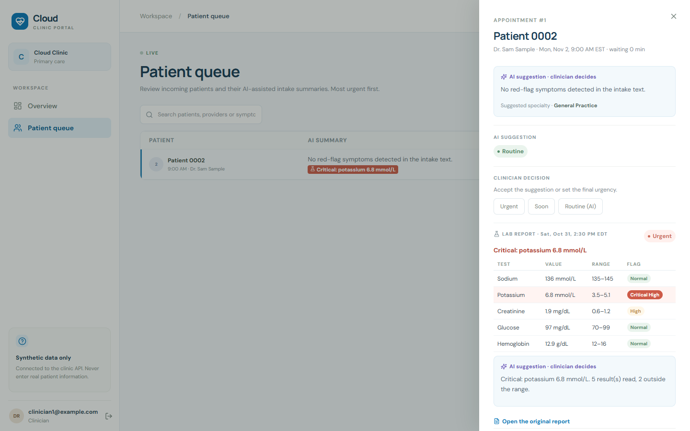
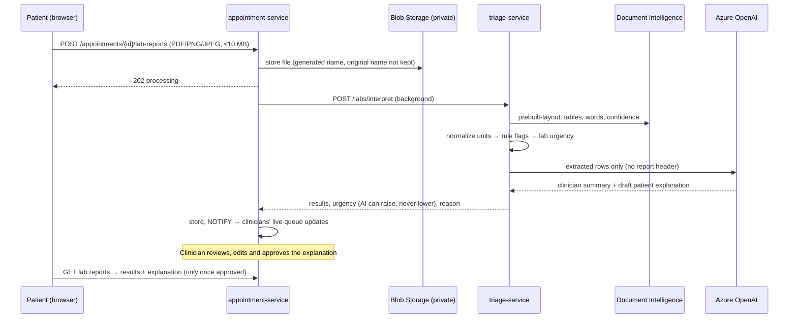

# Lab results

Patients attach a lab report (PDF or photo) to an appointment. The system reads each test, value,
unit and reference range, flags high, low and critical values with **fixed rules**, and drafts a
clinician summary and a plain-language explanation. The patient's urgency becomes the higher of
the symptom urgency and the lab urgency, and a critical value always makes them urgent. Nothing
reaches the patient until a clinician approves it.

## Flow

| Step | Where | Notes |
|---|---|---|
| Storage | `appointment-service/app/storage.py` | `LAB_STORAGE=azure-blob` (cloud, workload identity) or `local` (compose, kind, tests) |
| Extraction | `triage-service/app/labs/extract.py` | `LAB_EXTRACTOR=azure-document-intelligence` (PDFs and photos) or `text` (text PDFs via pypdf; photos go to manual review) |
| Units | `labs/normalize.py` | Mapping table: e.g. glucose mmol/L × 18.016 → mg/dL, hemoglobin g/L → g/dL. Unknown tests keep the printed unit and use the report's own range |
| Flags | `labs/rules.py` | `critical_low/high` from fixed thresholds, else `low/high` from the reference range, else `normal` |
| Verification | `labs/rules.py` | A value is marked **verify** if OCR confidence < 80 %, it's unreadable, or it's implausible (e.g. potassium 68 = a missed decimal point) |
| Summary | `labs/summary.py` | Azure OpenAI sees only the rows (test, value, unit, range, flag), never names/DOB/record numbers on the report. Template wording if the AI is off or fails |
| Urgency | `labs/interpret.py`, `appointment-service/app/queue.py` | Lab: any critical → urgent, any abnormal → soon, nothing readable → soon (a person must look). Queue: higher of symptom and lab urgency |

## Critical values (fixed rules, not the AI)

| Test | Critical below | Critical above | Unit |
|---|---|---|---|
| Potassium | 2.5 | 6.0 | mmol/L |
| Sodium | 120 | 160 | mmol/L |
| Glucose | 54 | 400 | mg/dL |
| Hemoglobin | 7.0 | | g/dL |
| Platelets | 20 | 1000 | 10^9/L |
| White blood cells | 2.0 | 30.0 | 10^9/L |
| Creatinine | | 5.0 | mg/dL |
| Calcium | 6.0 | 13.0 | mg/dL |
| INR | | 5.0 | |

Common adult panic values, for a course project on synthetic data: not clinical guidance.
Critical rules apply only when the test and unit are recognized.

## Who sees what

| | Patient | Clinician |
|---|---|---|
| Before approval | "Received. Your care team is reviewing it." | Everything: results, flags, verify marks, reason, AI summary, draft explanation, original file |
| After approval | The approved (possibly edited) explanation and the results with plain labels ("Above range"; never "critical") | Everything |

A clinician who sets the urgency **after** the latest lab result came in has the final say. A
decision made **before** a new critical result can't hide it: the queue goes to urgent again.

## Try it

Synthetic reports are in [`docs/samples/`](samples/) (made by
`services/triage-service/scripts/make_sample_lab_reports.py`):

| File | Expected |
|---|---|
| `lab-report-critical-potassium.pdf` | urgent, "Critical: potassium 6.8 mmol/L"; creatinine high |
| `lab-report-high-glucose-mmol.pdf` | soon; glucose 11.2 mmol/L → 201.8 mg/dL, HbA1c and cholesterol high |
| `lab-report-normal.pdf` | routine, "All results within range" |

Sign in as a demo patient, book, attach a report on the home page, then switch to the clinician
account to review and approve.

## Limits

- Extraction is checked on our synthetic reports and by unit tests, not measured on real-world
  reports. Low-confidence or implausible values are flagged for a person to check.
- Unit conversion covers the tests in the mapping table only.
- Processing runs as a background task in the appointment service. If a pod restarts mid-way the
  report stays "processing"; upload it again.
