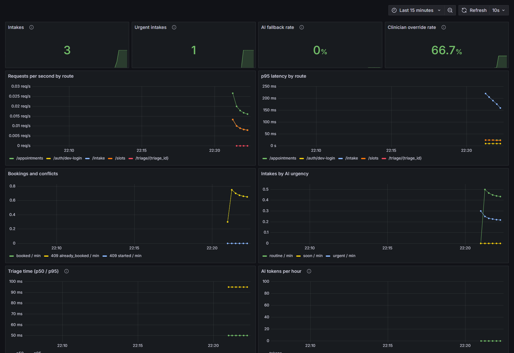

# Monitoring

Both services expose Prometheus metrics at `GET /metrics`. Prometheus scrapes them and Grafana
shows the **Clinic portal** dashboard.



## Run it locally

```bash
docker compose --profile monitoring up --build
```

- Grafana: http://localhost:3000 (opens on the dashboard; anonymous view, admin password is
  `GRAFANA_ADMIN_PASSWORD` in `.env`)
- Prometheus: http://localhost:9090

On AKS, the pods carry `prometheus.io/scrape` annotations (see `infra/k8s`), so any Prometheus
that honours them (for example Azure Managed Prometheus) picks them up.

## Metrics

| Metric | Service | What it tells you |
|---|---|---|
| `http_requests_total{method,route,status}` | appointment | Traffic and errors per endpoint |
| `http_request_duration_seconds{method,route}` | appointment | Latency per endpoint (histogram) |
| `appointments_booked_total` | appointment | Successful bookings |
| `appointment_booking_conflicts_total{reason}` | appointment | 409s: `already_booked` (double booking blocked) or `started` |
| `intakes_total{urgency}` | appointment | Intakes by the AI's urgency |
| `triage_service_call_duration_seconds` | appointment | Time to get a triage answer (redaction + AI + network) |
| `triage_fallbacks_total` | appointment | Intakes stored with the safe fallback instead of an AI answer |
| `triage_reviews_total{outcome}` | appointment | Clinician decisions: `accepted` or `overridden` |
| `queue_stream_clients` | appointment | Clinicians with the live queue open |
| `triage_requests_total{urgency,fallback}` | triage | Results by urgency and fallback reason |
| `triage_duration_seconds` | triage | Redaction plus AI call |
| `redacted_entities_total{entity}` | triage | Requests in which a kind of personal detail was removed |
| `llm_tokens_total` | triage | Tokens used by Azure OpenAI (drives cost) |

## Privacy rules for metrics

- Labels only ever hold route **templates** (`/triage/{triage_id}`), status codes, urgency levels,
  entity **types** and fallback reasons. Never IDs, emails or symptom text. Tests check this.
- `/metrics` is not public: nginx answers `404` for `/api/metrics`, and in Kubernetes only
  in-cluster Prometheus reaches the pods.

## What to watch

| Signal | Why it matters |
|---|---|
| AI fallback rate going up | Azure OpenAI is failing (quota, outage, bad output): intakes still work but get "review manually" |
| Override rate | How often clinicians disagree with the AI; a sudden change suggests a prompt or model problem |
| Urgent intakes | Workload for clinicians right now |
| p95 latency of `/intake` | Patients wait for this call; it includes the AI |
| AI tokens per hour | Azure OpenAI cost |
