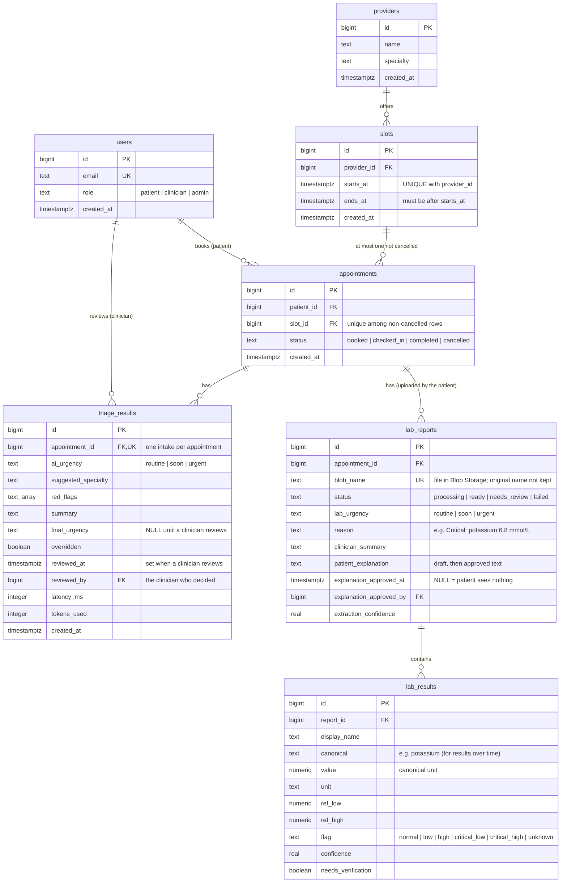

# Database Schema (v1)

Source of truth: [`services/appointment-service/db/schema.sql`](../services/appointment-service/db/schema.sql)
and the migration [`schemav2_lab_results.sql`](../services/appointment-service/db/schemav2_lab_results.sql) (lab reports).
Synthetic seed data: [`services/appointment-service/db/seed.sql`](../services/appointment-service/db/seed.sql).



## Rules the database enforces

| Rule | Constraint |
|---|---|
| A provider can't have two slots starting at the same time | `UNIQUE (provider_id, starts_at)` on `slots` |
| A slot has at most one active appointment (blocks double booking, even when requests race). Cancelled rows don't count, so a cancelled slot can be booked again | partial unique index `appointments (slot_id) WHERE status <> 'cancelled'` |
| One intake (triage result) per appointment | unique index on `triage_results (appointment_id)` |
| Slots end after they start | `CHECK (ends_at > starts_at)` |
| Role, status and urgency only take the listed values | `CHECK ... IN (...)` |
| Every reference points at a real row | foreign keys on all `*_id` columns |

## Live updates

Triggers on `appointments` and `triage_results` run `pg_notify('queue_changed', ...)` after
every insert, update or delete. `GET /queue/stream` listens on that channel and pushes the new
queue to clinicians, so all service replicas see every change.

## Notes and open questions

- All times are `timestamptz` and stored in UTC. The frontend converts to local time.
- Symptom text is **not** stored. Only the structured triage result is.
- `triage_results` also stores `suggested_specialty` and `red_flags`, so the full AI result
  from `docs/api.md` can be shown to the clinician later.
- Cancelling sets `status = 'cancelled'` instead of deleting the row, so the history is kept and
  the slot becomes bookable again. Queries for free slots must ignore cancelled appointments
  in the same way.

## Loading it locally

`docker compose up` runs `schema.sql` and then `seed.sql` the first time the database volume
is created. After editing either file, reset the database:

```bash
docker compose down -v
docker compose up --build
```
