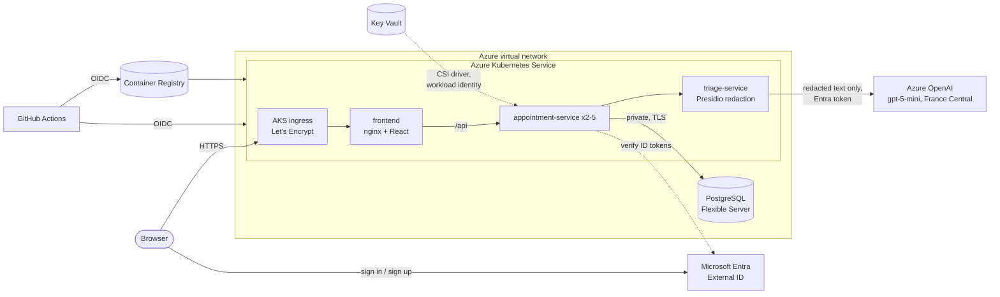

# Infrastructure and deployment

Everything runs on **Microsoft Azure** in `canadacentral`, except Azure OpenAI in
`francecentral`: our Azure for Students subscription only allows five regions and has chat-model
quota only in France Central.

| Folder | What it is |
|---|---|
| `terraform/` | Virtual network, AKS, ACR, PostgreSQL Flexible Server, Azure OpenAI, Key Vault, workload identity, budget alert, GitHub deploy identity |
| `k8s/` | Kubernetes manifests: a local overlay for kind and an AKS overlay ([README](k8s/README.md)) |
| `monitoring/` | Prometheus and Grafana for docker compose ([docs](../docs/monitoring.md)) |
| `scripts/deploy.sh` | Builds, pushes and deploys from a laptop (same steps as the deploy workflow) |
| `scripts/export-github-vars.sh` | Copies Terraform outputs into GitHub Actions variables, for automatic deploys |



**No keys anywhere:** GitHub → Azure uses OIDC; pods reach Key Vault and Azure OpenAI with AKS
workload identity (Azure OpenAI has key auth turned off). The database has no public endpoint:
only the cluster's virtual network can reach it. The one secret, the database password, is
generated by Terraform and kept in Key Vault.

## First deployment (one person, about 45 minutes)

**Tools:** Azure CLI, Terraform ≥ 1.6, Docker, kubectl, Python (used by the deploy script). Fill in `docs/cloud-accounts.md` as you go.

### 1. Sign in and create the Terraform state storage (once)

```bash
az login
az account set --subscription <subscription id>
az group create --name rg-clinicportal-tfstate --location canadacentral
az storage account create --name <unique name, e.g. clinicportaltf123> \
  --resource-group rg-clinicportal-tfstate --location canadacentral \
  --sku Standard_LRS --allow-blob-public-access false --min-tls-version TLS1_2
az storage container create --name tfstate --account-name <that name> --auth-mode login
az role assignment create --role "Storage Blob Data Contributor" \
  --assignee "$(az ad signed-in-user show --query id -o tsv)" \
  --scope "$(az storage account show --name <that name> --query id -o tsv)"
```

### 2. Create the sign-in tenant (Microsoft Entra External ID, about 10 minutes, free)

Patients sign up with their email address; this is a separate "external" tenant so they never
become users of the university directory.

1. Go to the [Microsoft Entra admin center](https://entra.microsoft.com) → **Entra ID** →
   **Overview** → **Manage tenants** → **Create** → **External** → choose your subscription and
   resource group, pick a name and a **domain name** (the subdomain, e.g. `clinicportaldemo`).
   Copy the new **Tenant ID**.
2. Switch to the new tenant (top-right settings → *Directories*). **App registrations** →
   **New registration**: name `clinic-portal-web`, supported account types *Accounts in this
   organizational directory only*, redirect URI **Single-page application (SPA)** =
   `https://<dns_label>.canadacentral.cloudapp.azure.com`. Add a second SPA redirect URI
   `http://localhost:5173` for local testing. Copy the **Application (client) ID**.
3. In that app: **Token configuration** → **Add optional claim** → token type **ID** → `email`.
4. **External Identities** → **User flows** → **New user flow**: name `signup-signin`,
   identity provider **Email with password**, attributes: Email Address. Create it, then open
   it → **Applications** → **Add application** → `clinic-portal-web`.

### 3. Fill in the variables and create everything

```bash
cd infra/terraform
cp terraform.tfvars.example terraform.tfvars   # git-ignored; IDs and emails only
terraform init -backend-config="storage_account_name=<state account>"
terraform plan -out tfplan        # review it: this starts billing
terraform apply tfplan
```

AKS, PostgreSQL and Azure OpenAI take 10–15 minutes. If the Azure OpenAI deployment fails with a
quota error, open [Azure AI Foundry](https://ai.azure.com) → *Quotas* for your region, or set
`openai_model` to another model your subscription offers; the app keeps working meanwhile
(triage falls back to "soon, review manually").

### 4. Deploy

```bash
bash infra/scripts/deploy.sh
```

It builds the three images, pushes them to the registry, installs cert-manager, applies the AKS
overlay with this deployment's values, loads the database schema and smoke-tests the site. Run
it again after merging changes. The app is at
`terraform -chdir=infra/terraform output -raw app_url`. Sign up with your email address; emails
listed in `clinician_emails` become clinicians when they sign in.

**Automatic deploys from GitHub** (`.github/workflows/deploy.yml`) need an app registration
with a GitHub OIDC credential. Our university tenant refuses that credential, so
`enable_github_deploy_identity` is `false`. In a tenant that allows it: set it to `true`,
`terraform apply`, then `bash infra/scripts/export-github-vars.sh`; every merge to `main` that
passes CI then deploys by itself.

### 5. Give teammates access

Invite them to the subscription's resource group (portal → resource group → *Access control
(IAM)* → *Add role assignment* → Contributor → invite their email). Guest invites are allowed in
our tenant.

## Cost

Roughly, with the defaults: AKS control plane free + one `Standard_B4ps_v2` ARM node (~$50/month),
PostgreSQL `B1ms` (~$15/month), ACR Basic (~$5/month), Key Vault and Entra External ID free at
this scale (External ID is free for the first 50,000 monthly users), `gpt-5-mini` well under a
cent per intake. The budget alert emails everyone at 25/50/80/100 % of `budget_amount_usd`.

**Stop paying when you're not demoing:**

```bash
az aks stop --resource-group rg-clinicportal --name aks-clinicportal
az postgres flexible-server stop --resource-group rg-clinicportal --name psql-clinicportal
```

(`start` to resume; Azure restarts a stopped PostgreSQL server automatically after 7 days.)
After the course: `terraform destroy`, then delete `rg-clinicportal-tfstate` and the external
tenant.

## What our Azure for Students subscription allowed (and what we did)

| Limit we hit | Result |
|---|---|
| Only 5 regions allowed (policy) | Everything in `canadacentral`; Azure OpenAI in `francecentral` |
| No chat-model quota in `canadacentral` | `gpt-5-mini` (500K TPM quota) in `francecentral` |
| `B2s` not offered; 0 vCPU quota for D-series v7 | Only B-series v2 ARM sizes have quota and are accepted by AKS: one `Standard_B4ps_v2` node, images built for arm64 + amd64 |
| 6 vCPUs per region in total | Can't run two 4-vCPU pools at once, so the node pool kept the name `rotation` from the resize (AKS can't rename pools) |
| AKS system pods reserve ~1.2 CPU | 2 vCPU wasn't enough; the add-on's unused default ingress controller is off and ours runs 1 replica |
| Tenant refuses GitHub OIDC credentials | Deploy with `infra/scripts/deploy.sh` |
| External ID tenant refused (region policy); user consent to apps disabled | Live site uses the demo sign-in (`auth_mode = "dev"`); Entra External ID is ready in code |

## If something is blocked

| Problem | Fallback |
|---|---|
| `RequestDisallowedByPolicy` | Azure for Students only allows some regions. Check with `az policy assignment list --query "[].parameters"` and set `location` to an allowed one |
| Azure OpenAI quota or model not available | Change `openai_model` (e.g. `gpt-4.1-mini` / `GlobalStandard`), or ask for quota in Azure AI Foundry. Triage falls back safely until it works |
| `RequestDisallowedByPolicy`/`BadRequest` for the VM size | Azure for Students only offers some sizes; the AKS error lists them. Set `aks_node_size` to one of them (x86 sizes only: the ARM `p` sizes need ARM images) |
| `dns_label` already taken | Pick another; it must be unique in the region (and update the SPA redirect URI) |
| Sign-in pop-up says the redirect URI is wrong | The SPA redirect URI in the external tenant must match the app URL exactly |
| Certificate not issued | `kubectl -n clinic-portal describe certificate app-tls`; Let's Encrypt needs port 80 reachable on the ingress IP |
| Database job failed | `kubectl -n clinic-portal logs job/db-init` |
