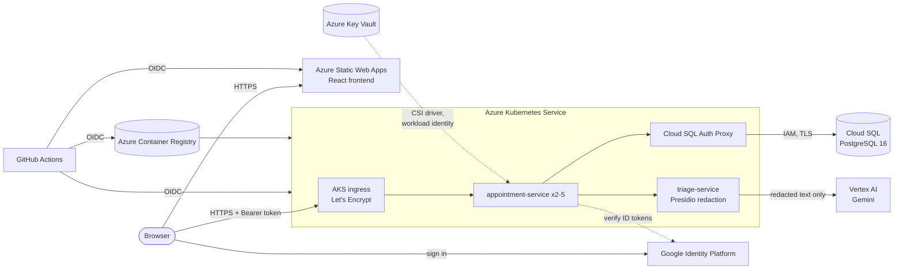

# Infrastructure and deployment

| Folder | What it is |
|---|---|
| `terraform/` | Azure (AKS, ACR, Key Vault, Static Web Apps, budget, GitHub deploy identity) and Google Cloud (Cloud SQL, Vertex AI, Identity Platform, Workload Identity Federation, budget) |
| `k8s/` | Kubernetes manifests: a local overlay for kind and an AKS overlay ([README](k8s/README.md)) |
| `monitoring/` | Prometheus and Grafana for docker compose ([docs](../docs/monitoring.md)) |
| `scripts/export-github-vars.sh` | Copies Terraform outputs into GitHub Actions variables for the deploy workflow |



Cross-cloud access is **keyless**: GitHub → Azure uses OIDC; pods → Key Vault use AKS workload
identity; pods → Cloud SQL and Vertex AI exchange their Kubernetes token for short-lived Google
credentials (Workload Identity Federation). No cloud keys are stored in GitHub or in the repo.

## First deployment (one person, about 30 minutes)

Do issue #4 first: decide whose Azure subscription and GCP billing account host everything, and
fill in `docs/cloud-accounts.md`.

**Tools:** Azure CLI, Google Cloud CLI, Terraform ≥ 1.6, GitHub CLI.

1. **Sign in to both clouds**
   ```bash
   az login
   az account set --subscription <subscription id>
   gcloud auth login
   gcloud auth application-default login
   gcloud config set project <gcp project id>
   ```
2. **Create the Terraform state bucket** (private Cloud Storage, once)
   ```bash
   gcloud storage buckets create gs://<project>-tfstate --location=us-central1 \
     --uniform-bucket-level-access --public-access-prevention
   gcloud storage buckets update gs://<project>-tfstate --versioning
   ```
3. **Fill in the variables**
   ```bash
   cd infra/terraform
   cp terraform.tfvars.example terraform.tfvars   # git-ignored; IDs and emails only
   ```
4. **Create everything** (review the plan before typing `yes`: this starts billing)
   ```bash
   terraform init -backend-config="bucket=<project>-tfstate"
   terraform plan -out tfplan
   terraform apply tfplan
   ```
   AKS and Cloud SQL take 10–15 minutes.
5. **Hand the outputs to GitHub and deploy**
   ```bash
   cd ../..
   bash infra/scripts/export-github-vars.sh
   gh workflow run deploy.yml
   ```
   From then on, every merge to `main` that passes CI deploys automatically.
6. **Open the app:** `terraform -chdir=infra/terraform output frontend_url`. Sign up with a
   real email address (Identity Platform sends a verification link). Emails listed in
   `clinician_emails` get the clinician role when they sign in.

## Cost

Roughly, with the defaults: AKS control plane free + one `Standard_B2s` node (~$30/month),
Cloud SQL `db-f1-micro` (~$9/month), ACR Basic (~$5/month), Static Web Apps Free, Key Vault and
Identity Platform pennies, Gemini Flash a few cents per hundred intakes. Budget alerts fire at
25/50/80/100 % of `budget_amount_usd` on **both** clouds (GCP counts usage before credits so the
alerts fire while credits are being spent).

**Stop paying when you're not demoing:**

```bash
az aks stop --resource-group rg-clinicportal --name aks-clinicportal
gcloud sql instances patch clinicportal-db --activation-policy=NEVER
```

(`az aks start` / `--activation-policy=ALWAYS` to resume.) After the course:
`terraform destroy`, then delete the state bucket.

## If something is blocked

| Problem | Fallback |
|---|---|
| Can't create the app registration (`azuread_application`) in a student tenant | Ask the instructor, or remove the "GitHub Actions deploy identity" block from `azure.tf` and run the deploy steps from a laptop: they're the same commands as in `deploy.yml` |
| `dns_label` already taken | Pick another; it must be unique in the Azure region |
| Re-creating after a destroy fails on `aks-pool` | Google keeps deleted identity pools for 30 days. Undelete it (`gcloud iam workload-identity-pools undelete aks-pool --location=global`) or rename it in `gcp.tf` and `cloud.env` |
| Certificate not issued | `kubectl -n clinic-portal describe certificate api-tls`; Let's Encrypt needs port 80 reachable on the ingress IP |
| Database job failed | `kubectl -n clinic-portal logs job/db-init -c cloud-sql-proxy` (credentials) and `-c psql` (SQL) |
